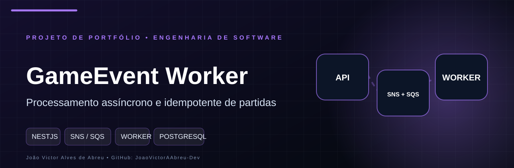
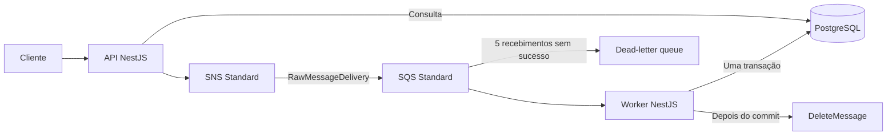
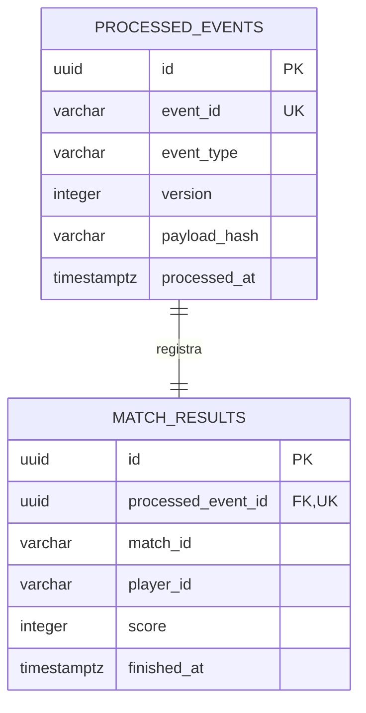

<p align="center">
  
</p>

# GameEvent Worker

Backend de portfólio que recebe resultados de partidas e os processa de forma assíncrona. A API confirma a publicação no SNS; um worker separado consome a SQS e grava o resultado no PostgreSQL com idempotência transacional.

**NestJS · TypeScript · MikroORM · PostgreSQL · AWS SDK v3 · SNS · SQS · Docker · Jest**

Sem frontend ou autenticação. Os serviços ficam restritos ao localhost. Não há hospedagem pública da API nem recursos AWS criados automaticamente.

## Arquitetura



- `apps/api`: REST, DTOs, Swagger e consulta de resultados.
- `apps/worker`: aplicação Nest sem servidor HTTP; consumo e desligamento gracioso.
- `libs/domain`: contrato de evento, hash canônico e processamento.
- `libs/database`: entidades, configuração e migrations.
- `libs/messaging`: clientes AWS, publicação e consumo.
- `docker`: inicialização idempotente do SNS/SQS local.
- `scripts`: demonstrações executáveis com asserções e timeouts.

O SNS permite distribuir um evento para consumidores independentes; a SQS retém trabalho e desacopla a disponibilidade do produtor e do worker. Este MVP tem uma assinatura e um consumidor, sem inventar outros microsserviços para justificar o tópico.

## Executar com Docker

Requisitos: Docker Engine e Compose; Node.js 24 para testes e demonstrações no host.

```bash
cp .env.example .env
chmod 600 .env
npm ci --ignore-scripts
npm run build
docker compose build api
docker compose up -d --no-build --wait api worker
npm run demo
```

O Compose inicializa a mensageria e aplica migrations antes da API e do worker. Não existe sincronização automática de schema.

- Swagger: http://localhost:3004/docs
- OpenAPI: http://localhost:3004/docs-json
- Health: http://localhost:3004/api/v1/health
- PostgreSQL: localhost:5436
- Emulador AWS: localhost:4566
- PostgreSQL de testes: localhost:5437, iniciado separadamente.

```bash
docker compose ps -a
docker compose logs -f api worker
docker compose down
```

`down` preserva o volume PostgreSQL. O estado do Moto é transitório: se seu container for recriado, tópicos/filas são recriados pelo inicializador, mas mensagens pendentes são perdidas. Reiniciar apenas API/worker preserva a fila enquanto o Moto continua ativo. Resultados processados sobrevivem à recriação dos containers graças ao volume do PostgreSQL.

## Contrato HTTP

| Método e rota | Resposta |
|---|---|
| `POST /api/v1/events/match-finished` | `202` somente após SNS retornar `MessageId` |
| `GET /api/v1/events/:eventId` | `200` com resultado ou `202 not_available` |
| `GET /api/v1/health` | `200` se API e banco respondem; `503` se banco indisponível |

```bash
curl -i http://localhost:3004/api/v1/events/match-finished \
  -H 'Content-Type: application/json' \
  -d '{"eventId":"evt-001","matchId":"match-123","playerId":"player-456","score":1500,"finishedAt":"2026-10-26T18:00:00Z"}'

curl -i http://localhost:3004/api/v1/events/evt-001
```

IDs: 1–100 caracteres ASCII alfanuméricos, `_` ou `-`. Score inteiro entre 0 e 1.000.000. `finishedAt` exige ISO 8601 com fuso e data válida. Campos desconhecidos são rejeitados. Datas futuras não são proibidas neste MVP.

Publicação aceita:

```json
{"eventId":"evt-001","status":"accepted","messageId":"identificador-sns"}
```

Processado:

```json
{
  "eventId":"evt-001",
  "eventType":"match.finished",
  "version":1,
  "status":"processed",
  "processedAt":"2026-10-26T18:00:01.000Z",
  "result":{"id":"uuid","matchId":"match-123","playerId":"player-456","score":1500,"finishedAt":"2026-10-26T18:00:00.000Z"}
}
```

Sem resultado disponível:

```json
{"eventId":"evt-001","status":"not_available","message":"Resultado ainda não disponível. O evento pode estar em trânsito ou não ter sido recebido."}
```

Não existe registro de recebimento na API: a consulta não distingue identificador desconhecido, evento em trânsito ou evento que falhou e foi à DLQ. Não afirma inexistência e não promete que todo `202` será processado. O endpoint de health verifica o banco; disponibilidade SNS/SQS é observada nas operações e logs.

Erros seguem `{ statusCode, code, message, details? }`. Validação retorna `400 VALIDATION_ERROR`; publicação malsucedida retorna `503 PUBLISH_UNAVAILABLE`. Em falha ambígua de rede, uma publicação pode ter ocorrido antes do erro: tente novamente **com o mesmo eventId e conteúdo**.

## Idempotência e banco



A transação reserva `eventId` com constraint única, insere o resultado e confirma ambos juntos. Uma falha no resultado desfaz o marcador. A consulta após conflito usa um EntityManager novo, porque a transação anterior foi abortada.

- Mesmo ID e conteúdo equivalente: duplicata segura, confirmada sem novo resultado.
- Mesmo ID com conteúdo diferente: `EVENT_ID_CONFLICT`, sem sobrescrever dados; mensagem é reentregue e eventualmente vai à DLQ.
- O hash normaliza horário para UTC e usa ordem fixa dos campos.
- Eventos com IDs diferentes para o mesmo match/player são registros distintos. Não há atualização de placar nem ranking.
- Queda após commit e antes de `DeleteMessage`: a reentrega encontra o marcador e pode ser confirmada.

A garantia é processamento idempotente no banco sobre entrega pelo menos uma vez; não é entrega exatamente uma vez de ponta a ponta.

## Worker, retries e DLQ

Envelope interno: `{ eventType: "match.finished", version: 1, data: <DTO> }`.

- Assinatura SNS/SQS com `RawMessageDelivery=true`.
- Long polling de 20 segundos e uma mensagem por vez.
- Visibility timeout de 60 segundos; consultas/locks de banco têm timeout de 5 segundos.
- SQS DLQ após 5 recebimentos; retenção de 4 dias na origem e 14 na DLQ.
- SDK: até 2 tentativas por chamada, conexão de 2 segundos, timeout SNS de 5 segundos e SQS de 25 segundos (para permitir long polling).
- Falha de polling: espera exponencial de até 30 segundos, sem derrubar o processo.
- Mensagem inválida/conflitante ou falha de persistência: não excluir.
- Cada exclusão usa o `receiptHandle` da tentativa atual.
- SIGTERM/SIGINT interrompem polling e aguardam a mensagem atual. Limite de drenagem de 45 segundos, com 50 segundos de tolerância no Compose; se interrompido, a mensagem pode ser reentregue.
- Heartbeat do worker mede comunicação recente com a fila, não substitui métricas de negócio.

Logs JSON registram ação, identificadores, tentativa, duração e resultado, sem credenciais ou payload completo. O SNS pode aceitar uma publicação que posteriormente não seja entregue à fila; a DLQ deste MVP cobre falhas do consumidor SQS, não todas as falhas de entrega SNS. Uma DLQ da assinatura SNS é evolução futura.

## Desenvolvimento e testes

```bash
npm ci --ignore-scripts
npm run lint
npm run typecheck
npm test
npm run build

docker compose up -d --wait moto test-db
npm run check:messaging
npm run test:integration
```

Os testes usam banco exclusivo `gameevent_test`, porta 5437, e filas/tópicos com UUID. Limpam somente tabelas desse banco e recursos de mensageria criados pela suíte. Não use um banco compartilhado para testes.

```bash
# Para executar API/worker diretamente no host:
docker compose up -d --wait db moto
npm run migration:up
npm run messaging:init
npm run start:api
# Em outro terminal:
npm run start:worker
```

Não execute o worker do host junto ao worker Docker durante demonstrações determinísticas: eles competem pelas mensagens.

Comandos adicionais: `npm run migration:pending`, `npm run migration:up:prod`, `git diff --check`.

A suíte cobre contrato inválido, publicação, falhas, idempotência, corrida concorrente, rollback, consulta HTTP, fluxo completo via SDK e recuperação de mensagem após commit sem exclusão. Os testes usam PostgreSQL real e SNS/SQS **emulados**, sem credenciais AWS reais.

## Demonstração para entrevista

```bash
npm run demo
npm run demo:recovery
```

A demonstração básica publica, consulta o resultado, repete o ID e verifica validação. A de recuperação para o worker, publica, comprova `not_available`, retoma o consumo, reinicia banco/API/worker e verifica persistência. Depois envia uma mensagem inválida e aguarda sua chegada à DLQ com as configurações reais do Compose. Uma leitura em andamento no instante do desligamento pode reservar uma mensagem por até um visibility timeout; a retomada aguarda essa janela. Pode levar aproximadamente 6 minutos por causa do visibility timeout. Execute-a em ambiente local exclusivo: ela reinicia os serviços deste projeto. Nenhuma das demonstrações apaga volumes.

O relatório de execução está em [docs/VALIDACAO.md](docs/VALIDACAO.md). Decisões e limites estão em [docs/DECISOES.md](docs/DECISOES.md). Configuração opcional AWS em [docs/AWS.md](docs/AWS.md).

## CI e limites

GitHub Actions executa lint, typecheck, testes unitários, PostgreSQL/Moto, testes de integração, build Docker e demonstração básica contra containers. Não depende de conta AWS ou token LocalStack.

Moto 5.2.2 foi escolhido por ser um emulador independente acessível sem conta; versões de imagens e dependências ficam fixadas. Não simula perfeitamente IAM, latência, falhas regionais e todos os comportamentos AWS. A execução na AWS real é opcional e deve ser identificada separadamente.

Este projeto demonstra DTOs, integração AWS SDK, migrações, transações, filas, idempotência, concorrência, recuperação, Docker e CI. Evoluções possíveis: métricas/alertas, inspeção e redrive manual de DLQ, DLQ de assinatura SNS, processamento em lote e outbox se um futuro produtor também gravar estado de negócio.
